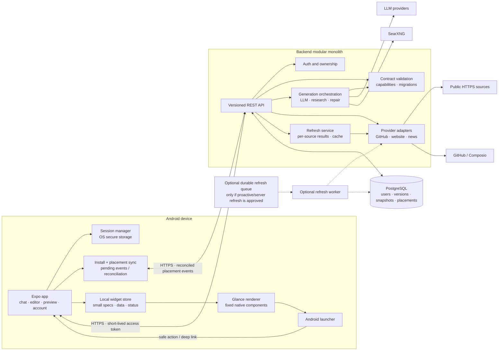

# WidgetComposer target architecture

**Status:** reviewed architecture baseline; remaining product and implementation decisions still require approval before their respective changes begin.
**Scope:** the existing backend repository, the Expo app in `../web2widgets`, and the Android home-screen runtime. This document supplements [ARCHITECTURE.md](./ARCHITECTURE.md), which remains the current-state overview and is intentionally not replaced.

## Executive recommendation

Keep WidgetComposer as a **modular monolith** with a declarative, versioned widget contract. The backend remains authoritative for validation, account ownership, connector access, web fetching, and server-side refresh. The app owns the editor, preview, authentication lifecycle, and synchronization. Android Glance renders a bounded, already-fetched payload; the launcher widget does not receive API or connector credentials and does not make arbitrary network requests.

Do not introduce a microservice fleet, arbitrary generated code, a formula interpreter, a public widget marketplace, or a durable queue just to resemble another widget product. First make the existing contract and lifecycle reliable across the three implementations: backend TypeScript, app TypeScript, and Android Kotlin.

The recommended order is:

1. Agree on and version the shared widget contract.
2. Wire Android placement/removal to the existing backend instance API using a stable app-install identity and a local reconciliation queue.
3. Make source refresh results independently observable and preserve successful source data when another source fails.
4. Finish the lock-screen action only as an explicit, versioned, opt-in native capability.
5. Improve session storage and image transfer when the product's measured needs justify those changes.

No product or infrastructure change in this proposal should be implemented before review.

## Evidence and boundaries

### Verified in the repositories

- Backend: Express 5 and TypeScript, PostgreSQL through `pg`, Zod, an API-owned anonymous-device session system, and Composio-backed GitHub access. LLM adapters include Anthropic, OpenRouter, and Google Gemini. Optional image generation uses OpenAI or a Playwright/ChatGPT browser profile; web research uses self-hosted SearXNG.
- App: Expo SDK 58, React Native 0.88, Expo Router, and a custom Kotlin Expo module. The Android widget renderer is Jetpack Glance with a legacy `RemoteViews` fallback.
- The backend validates a fixed, declarative `WidgetSpec` (currently schema version 7); model output is converted from a flat graph to a bounded tree. The component and provider catalogs are allowlisted. Specs do not contain executable code or credentials.
- Current providers are GitHub queries, public HTTPS website pages, RSS/Atom news, Android device metrics, and the device-local clock. Android-only values are read on-device.
- PostgreSQL currently stores anonymous users and refresh-token hashes, generation runs, widgets and immutable versions, placement records, per-widget snapshots, and user-owned image bytes. `widget_snapshots` is one latest snapshot per widget/version, not one table per website.
- The app writes a widget spec and its latest data to Android `SharedPreferences`. The Glance widget reads this local payload. The app refreshes data when opened/returned to the foreground or when a user invokes refresh; `refreshMinutes` is a freshness preference, not a scheduled-update guarantee.
- The backend already exposes placement registration/removal endpoints, but the inspected app placement path does not call them. Android placement state is therefore currently local-only from the app's point of view.
- The API rate limiters, including the tighter manual-refresh limiter, are process-local. They do not coordinate multiple API replicas.
- App access tokens are held in memory; the rotating refresh token is stored in a private app file. This is not equivalent to OS-backed secure storage.
- `widget_instances` currently has a `device_id` and platform widget ID, but the app does not reconcile it with Android placement/deletion events.
- Current refresh resolves a widget's data sources together with `Promise.all`; a failure from one source can make the whole fetch fail and retain the prior widget snapshot. This is safe against blanking good data, but it does not expose per-source freshness.
- Optional `minWidthDp` / `minHeightDp` fields exist in the spec type/schema. Actual widget composition uses Glance's launcher-provided size and compact-layout thresholds; the audit did not find these optional spec fields used by the Android renderer.
- The backend's existing untracked `ARCHITECTURE.md` is preserved. The app and backend worktrees contain substantial pre-existing changes and generated Android files; this proposal does not authorize cleaning or reverting them.

### KWGT evidence boundary

The prior KWGT inspection was **UI-only**. The observed flow included an “Add widget” entry, Android's launcher-owned add confirmation, and an editor showing Items, Background, Layer, Globals, and Flows sections with Save/Restore/Add and preview controls. No KWGT source was decompiled or read.

The user-provided claims about KWGT internals (for example, `RenderModule`/`PaintModule` class names, a module inflater, bitmap publication, touch-area RemoteViews, formula or data-broker implementations) are not independently verified here. They are treated as design inspiration, not as evidence about KWGT internals or as a request to copy proprietary implementation. The reusable product-level patterns are: an explicit item tree, scoped configuration, named data sources, native launcher placement, preview, and a controlled action system.

### Review of the supplied Skia / Canvas proposal

The supplied notes correctly separate three concerns: **what a widget means** (component/schema), **how an editor draws and manipulates it** (editor renderer and interactions), and **how Android publishes it** (AppWidget/RemoteViews runtime). WidgetComposer already has a declarative tree and an Android renderer boundary, but it does not currently have a freeform canvas editor or a cross-platform geometry/layout engine.

| Supplied proposal | Assessment for WidgetComposer |
| --- | --- |
| One versioned component tree, registry and validator shared by renderers | Adopt. This matches the recommended canonical contract. Keep server semantic validation authoritative and require renderer compatibility tests. |
| React Native Skia for a drag/resize visual editor | Defer. The app is currently prompt-driven with a React Native spec preview, not a direct-manipulation canvas. Gesture Handler and Reanimated are dependencies, `react-native-svg` is present, but Skia is not. Add Skia only if users need positioned, rotated, or custom-path editing that the current tree cannot express. |
| Kotlin Canvas drawing to a Bitmap, published through RemoteViews | Keep as a possible second Android renderer, not the default replacement for Glance. It can unlock complex static shapes, but requires a canonical coordinate system, deterministic layout, bitmap memory/size limits, image and font handling, accessibility descriptions, resize behavior, and separately mapped hit regions/PendingIntents. |
| Support both Glance and Canvas/Bitmap renderers | Architect for capability negotiation, but do not maintain two production renderers until a concrete widget feature needs the second one. A component must not silently render differently or disappear when its renderer lacks support. |
| Build a rectangle/text/circle/row/column vertical slice before more graphics | Sensible only if freeform visual composition is approved as a product milestone. It is not a prerequisite for the current data-first, responsive home-screen widgets. |

**Decision — selected:** retain the current React Native preview + Jetpack Glance (with the existing RemoteViews fallback) as the implementation baseline. Do not migrate to Skia or Canvas-to-Bitmap now. This preserves existing behavior, avoids a second rendering architecture, and keeps work focused on the component system and widget contract rather than a graphics rewrite.

The component system, schema, registry, geometry/layout semantics, and renderer interfaces should remain renderer-independent. The shared, versioned contract and registry should be consumed consistently by the React Native preview and Android renderer. Implement standard components and shapes that fit the current tree and Glance capabilities first. Advanced graphics are not abandoned: add Skia editor graphics, a Canvas-to-Bitmap Android renderer, and renderer capability negotiation later only when specific requirements cannot be supported efficiently by Glance/RemoteViews.

Build the widget engine first and optimize its graphics implementation second. Do not block the component architecture on a graphics-engine migration, and preserve existing functionality while adding renderer abstractions.

If freeform editing is approved later, prototype one end-to-end slice (rectangle, text, circle/progress, row/column, one live binding, one tappable region) before adding a large component catalog. The prototype must render at compact and expanded launcher sizes, expose accessibility labels, bound bitmap memory, and demonstrate that preview geometry and Android touch regions agree. A simple allowlisted formatter such as percentage may be added to typed bindings; do not introduce a general-purpose formula language as part of the graphics change.

## Current end-to-end flow

1. The Expo app creates or refreshes an anonymous API session.
2. The user submits a prompt (and optionally an image). The backend normalizes the request, conditionally researches the web or reads supplied URLs, asks a configured model for structured output, converts and validates the spec, and makes bounded repair attempts.
3. The app requests preview data. Public web/news sources may be fetched; GitHub can use live connected data or explicitly flagged sample data.
4. The app saves the widget/version, stores the spec and data in Android preferences, and asks the launcher to pin it. Android assigns the platform widget ID and the module binds it to the saved widget ID.
5. Glance renders the payload at the actual launcher size. Widget taps can open the app; refresh opens the app, which calls the API and writes the new payload back to the module.
6. API snapshots are cached per widget and version. A failed refresh retains the last good data for that same version; a different version does not reuse unrelated source data.

This keeps API credentials out of the launcher process. The principal current lifecycle gap is that placement/removal is not synchronized to the server's `widget_instances` records.

## Proposed target architecture



### Responsibilities and boundaries

| Layer | Owns | Must not own |
| --- | --- | --- |
| Expo app | Prompt/editor UX, preview, account/connector flow, user-visible errors, session refresh, placement reconciliation | Connector secrets, authoritative spec validation, arbitrary rendering code |
| Shared contract | Versioned spec, component/action/provider identifiers, binding grammar, compatibility fixtures | Provider credentials, runtime network access |
| API | Auth, authorization, generation, save/version/publish, data/refresh endpoints, placement records | Android rendering or device-admin activation |
| Generation | Prompt preparation, optional bounded research, structured output, deterministic validation/repair | Unbounded model tools, executing model output |
| Provider adapters | Fetch and normalize one allowlisted source; enforce provider-specific timeout, size and credential rules | Direct model access to credentials or unvalidated network destinations |
| Postgres | Durable identity, widget/version history, normalized snapshots/status, generation telemetry, placement metadata | Serving as a public client data API |
| Android runtime | Render validated data locally; dispatch a small allowlisted action set | API calls, account tokens, arbitrary intents or arbitrary code |
| Optional worker | Durable retries and proactive refresh, if required by product behavior | Replacing launcher/app lifecycle guarantees Android does not provide |

Keep these boundaries in one backend deployment initially. A separate worker process can use the same domain services and PostgreSQL if/when background jobs are approved; it does not require splitting the API into microservices.

## Canonical widget contract

### Recommended source of truth

Create a small versioned `widget-contract` package whose canonical artifact is a renderer-neutral JSON Schema plus contract fixtures. Generate TypeScript types for the app/backend and a Kotlin-compatible schema/constants artifact for Android. The backend keeps the authoritative semantic checks that JSON Schema alone cannot express, such as ownership, binding-to-source consistency, provider capability, safe actions, and migration policy.

The repositories remain independently buildable. Each consumes a pinned contract release; CI rejects an app/backend/runtime combination whose declared supported schema ranges do not overlap. Avoid editing three handwritten unions for every new component.

### Contract content

Keep the contract declarative and bounded:

- Stable `schemaVersion` and renderer compatibility metadata.
- Semantic color tokens and typography roles. Preserve the existing six palette tokens (`background`, `surface`, `text`, `muted`, `accent`, `border`) and map them consistently to Material Design 3 roles; do not force a fixed purple palette.
- A fixed component tree and documented sizing/overflow behavior.
- Data source descriptors using allowlisted provider IDs, typed query/config values, and stable source IDs.
- Typed bindings with validation against declared source fields and item limits.
- Allowlisted actions. `open_url` must resolve to a trusted normalized item URL; it must not take a model-written arbitrary URL.
- Explicit accessibility text, loading/empty/error/sample states, and a predictable fallback when a renderer does not support a component.
- Hard limits for tree depth/count, text, data sources, image dimensions/bytes, total payload size, and action types.

Example shape (illustrative target, not a current API payload):

```json
{
  "schemaVersion": 8,
  "name": "Latest stories",
  "presentation": {
    "theme": "system",
    "refreshMinutes": 60,
    "palette": {
      "background": "#141218",
      "surface": "#211F26",
      "text": "#E6E1E5",
      "muted": "#CAC4D0",
      "accent": "#D0BCFF",
      "border": "#49454F"
    }
  },
  "dataSources": [
    { "id": "news", "connector": "news", "query": "latest_items", "url": "https://example.com/" }
  ],
  "root": {
    "type": "column",
    "children": [
      { "type": "text", "text": "Latest stories", "style": "title" },
      { "type": "list", "source": "news", "maxItems": 3 }
    ]
  }
}
```

The example's schema version is a proposal, not a decision to ship version 8 unchanged. The in-progress `lock_screen` action changes the accepted action set while the backend still reports schema version 7; the versioning rule in `widget-spec.ts` says contract changes require a new version. Resolve compatibility and migration before treating that action as released.

### Renderer contract

- Treat React Native preview and Glance as two renderers of the same semantic spec, not pixel-identical canvases.
- Define common token mapping, text truncation, item ordering, action meaning, empty/error states, and compact/medium/expanded layout rules.
- Use launcher-reported dimensions and stable compact breakpoints. Clarify whether `minWidthDp`/`minHeightDp` are removed, made effective, or replaced with explicit layout variants.
- Keep Android implementation within Glance/`RemoteViews` supported views. An arbitrary Compose screen cannot be embedded as a launcher widget.
- For any future iOS widget, add a separate WidgetKit renderer with explicit feature capability negotiation; the current native widget runtime is Android-only.

## Data and refresh design

### Provider interface

Each adapter should accept a validated source configuration and user/credential scope, then return a bounded normalized result plus freshness and safe error metadata:

```ts
type SourceResult = {
  sourceId: string;
  status: "fresh" | "stale" | "unavailable";
  fetchedAt: string | null;
  items: NormalizedItem[];
  error?: { code: string; retryable: boolean };
};

interface DataProviderAdapter<Config> {
  readonly id: string;
  validateConfig(input: unknown): Config;
  fetch(config: Config, context: ProviderContext): Promise<SourceResult>;
}
```

The app renders `dataBySourceId` plus `sample`, `updatedAt`, and source status. Keep the existing normalized item fields where possible so old widget versions remain readable.

### Refresh policy

1. Keep the default pull model for now: initial preview, foreground refresh, user-triggered refresh, and backend cache-on-read.
2. Treat `refreshMinutes` as a preferred maximum age, not a deadline. Report the actual `fetchedAt` and stale/error state.
3. Fetch independent sources with bounded concurrency. Persist each result independently, so one broken website does not make a healthy GitHub/news source look broken.
4. On failure, serve the last good result for that exact source and version with an explicit stale/error state. Never replace it with an empty success.
5. Deduplicate concurrent refreshes for the same owner/widget/version. Enforce both per-user and global/provider quotas across replicas before scaling horizontally.
6. Add a durable queue only if the product explicitly requires proactive server refresh, durable retry, or work that outlives a request. Android periodic work is best-effort and inexact (minimum interval 15 minutes); retain manual refresh.
7. Keep on-device metrics local. They use Android lifecycle updates and cannot be refreshed by a server worker.

The existing `/v1/widgets/:id/data?refresh=true` can remain the initial API. Its response should evolve to include per-source status and cache validators without breaking current clients.

### Website and news security

Retain the existing HTTPS-only public-page behavior: resolve and reject non-public addresses, pin DNS to the checked address, revalidate redirects, restrict supported ports/content types, and bound bytes, redirects, concurrency, and time. Continue treating retrieved page/search/feed text as untrusted input to the model. Never allow page content to override system instructions, expose credentials, choose arbitrary local/network destinations, or create executable widget content.

Images should be bounded by decoded dimensions and bytes as well as MIME type. Resolve image URLs only through trusted provider output or a user-uploaded asset owned by that account. The current base64-in-snapshot/preferences approach is workable for small data but should have a strict total payload budget.

## Persistence proposal

Do not migrate the database merely to normalize every JSON field. Keep immutable widget versions and the existing ownership model. The first persistence change should add observability and correct placement/source lifecycle, not replace PostgreSQL.

| Entity | Target purpose | Notes |
| --- | --- | --- |
| `users`, `refresh_tokens` | Account identity and rotating sessions | Add a provider identity mapping only when sign-in/account recovery is approved. Store refresh tokens only as hashes. |
| `widgets`, `widget_versions` | User-owned widgets and immutable spec history | Keep versions immutable; publish/rollback by pointing at a version ID. |
| `widget_instances` | One row per launcher placement | Add idempotent client event/reconciliation semantics; do not trust platform IDs as authorization. |
| `generation_runs` | Generation quality, cost, latency and outcome | Log safe metadata, never raw prompt, tokens, image bytes or source contents. |
| `widget_snapshots` or `widget_source_snapshots` | Last good normalized data and source freshness | Prefer per-source rows if independent status/failure retention is adopted; scope by owner/widget/version/source. |
| `widget_refresh_runs` | Auditable refresh attempts and safe error codes | Add when refresh support/diagnostics need history; avoid storing raw upstream responses. |
| `widget_image_assets` | User-owned image metadata and bytes/object key | Keep PostgreSQL bytes during beta if size is acceptable; move bytes to private object storage only with measured growth/backup needs. |
| `widget_refresh_jobs` | Durable retry/proactive scheduling | Add only with an approved queue/worker requirement. |

Illustrative normalized snapshot table if per-source refresh is approved:

```sql
CREATE TABLE widget_source_snapshots (
  widget_id uuid NOT NULL REFERENCES widgets(id) ON DELETE CASCADE,
  version_id uuid NOT NULL REFERENCES widget_versions(id) ON DELETE CASCADE,
  source_id text NOT NULL,
  status text NOT NULL CHECK (status IN ('fresh', 'stale', 'unavailable')),
  data_json jsonb,
  fetched_at timestamptz,
  attempted_at timestamptz NOT NULL DEFAULT now(),
  error_code text,
  PRIMARY KEY (widget_id, version_id, source_id)
);
CREATE INDEX widget_source_snapshots_due
  ON widget_source_snapshots (fetched_at) WHERE status <> 'fresh';
```

This is a proposal, not a migration. Keep a source-level cache owner-scoped; do not share GitHub results between users. A public-website cache may be shared only after a deliberate privacy, freshness, and canonicalization review. Keep credentials outside widget specs and snapshot JSON.

## API contract

### Existing routes to preserve

The API already has endpoints for device auth/refresh; catalogs; generation, validation, design review and preview; widget CRUD; immutable versions and publish/rollback; data refresh; placement registration/removal; GitHub connection; and health. Keep `/v1` compatibility while clients migrate.

### Proposed API behavior

| Surface | Proposed behavior |
| --- | --- |
| `GET /v1/widgets/components` | Return the versioned component/provider/action catalog and capability metadata, including renderer support. |
| `POST /v1/widgets/generate` | Return a validated spec and generation ID; return stable error codes for refusal, unavailable dependencies, rate limits and invalid output. |
| `POST /v1/widgets/:id/versions` + `/publish` | Keep save and publish explicit; editing a published widget should not silently change the live version. |
| `GET /v1/widgets/:id/data` | Return per-source data/status, `updatedAt`, stale state and safe error codes. Support ETag/conditional reads once client polling or background work needs them. |
| Existing `POST/DELETE /v1/widgets/:id/instances` | Make registration idempotent and reconcile add/remove events from a stable app-install ID. The widget receiver should not make authenticated network calls. |
| Optional refresh-history endpoint | Add only after `widget_refresh_runs` exists and the product needs in-app history. |

Authentication and ownership checks stay at the API boundary and in every resource query. Do not expose PostgreSQL directly to the mobile client. Keep one stable error envelope and avoid returning raw provider exceptions or HTML.

## Identity, actions, and security

### Account/session lifecycle

- Preserve anonymous device onboarding for the beta; do not force sign-in as an architectural prerequisite.
- Move the refresh token from a plain private file to OS-backed secure storage when the native build can include the dependency. Keep access tokens short-lived and in memory.
- Add explicit account recovery/linking before users rely on cross-device sync. Migration must attach anonymous data without changing widget ownership or leaking it.
- Make logout/revocation clear local session, connector state, local widget cache as appropriate, and queued placement events with visible failure behavior.

### Action policy

Every action must have a stable ID, documented permission/capability, user-visible intent, and renderer fallback. Use explicit Android `PendingIntent` targets and safe URI allowlists. Opening a web item must use its validated provider URL. Refresh should route to the app and preserve the last good widget until data is refreshed.

For `lock_screen`, retain the user's prior product choice only after architecture approval: explicit user-triggered setup and Android-owned admin consent; no hidden activation, no generic “screen control” permission, and no ability to wipe/lock on model output alone. Keep the action opt-in, explain the device-admin capability and disable path, and fail closed if approval is absent or revoked. Because this action is new native behavior, version it and test each Android receiver/rendering route before release.

### Threat controls

- Keep all API, LLM, Composio, and image-provider credentials server-side.
- Continue parameterized SQL, schema validation, owner-scoped reads/writes, body limits, and bounded image inputs.
- Share rate limits and refresh deduplication across replicas before horizontal scaling (Redis or a database-backed limiter are options; choose based on measured load).
- Separate operational logs from user content. Current generation logging includes a short prompt prefix; remove prompt text and use request/run IDs, provider, token counts, latency, and stable error codes instead.
- Add retention and deletion rules for account data, widget versions, snapshots, images, and generated telemetry. Document what external providers receive.
- Add security tests for cross-user object access, refresh-token replay, image ownership/expiry, SSRF redirects/DNS rebinding, untrusted page prompt injection, action validation, and size/time limits.

## Reliability, performance, and observability

- Keep API handlers thin and push generation/provider work into domain services.
- Use bounded concurrency for independent provider sources, and provider-level timeout/size limits. Use single-flight refresh per widget/source to avoid stampedes.
- Preserve last-good snapshots and show their age/error state in both app and widget. Avoid stale data looking freshly updated.
- Add request/run correlation IDs across app, API, database writes, and provider calls. Do not log prompts or fetched page contents.
- Track generation success/refusal/invalid rates, model cost/tokens/latency, source refresh success/staleness, image sizes, pin success, placement-sync lag, and native render errors.
- Keep SharedPreferences for small, bounded local widget records. Move to Room when local query/history/offline requirements arrive. Cache image files by content hash and store local references instead of large base64 blobs.
- Do not add Redis, an object store, or a job system until the associated scale or product requirement is real. If multi-replica rate limits/refresh jobs are approved, use one shared coordination service rather than process-local maps.

## Test and release strategy

1. **Contract tests:** canonical valid/invalid JSON fixtures run through backend validation, app types/preview, and Kotlin decoding. Include old-version fixtures and renderer capability checks.
2. **Backend unit tests:** provider normalization, source-level stale/failure behavior, URL validation/redirects, token rotation/reuse, ownership, action restrictions, image limits, and refresh idempotency.
3. **Backend integration tests:** real PostgreSQL migrations/transactions and API flows. PGlite remains fast for unit tests but is not the only evidence for production PostgreSQL behavior.
4. **App tests:** auth refresh/recovery, generation to preview/save, save/edit/publish/rollback, connector connection, manual/foreground refresh, errors, and placement-sync recovery.
5. **Android tests:** Glance rendering for compact/medium/expanded bounds, malformed/missing payload fallback, image failure, each allowed action, duplicate pin/delete events, and permission-not-granted/revoked behavior for device admin.
6. **Device matrix:** at least one AOSP-like launcher and Samsung launcher; supported API levels; light/dark mode; small and resized widgets; offline/slow network.
7. **Release gate:** backend typecheck/tests, app typecheck/lint, Android debug/release build, contract compatibility check, database migration test, and a complete device smoke test.

## Gaps and implementation roadmap

| Phase | Work after approval | Acceptance gate |
| --- | --- | --- |
| 0. Contract freeze | Review schema ownership, supported versions, action policy, refresh guarantees and identity boundary. Inventory all existing dirty changes; no resets or cleanup. | Written decisions and agreed compatibility rules. |
| 1. Contract compatibility | Publish canonical schema/fixtures; generate or pin TS/Kotlin contract artifacts; document old-version behavior. Resolve `lock_screen` versioning rather than shipping it under v7. | Same fixtures accepted/rejected consistently; app/backend/runtime version ranges overlap. |
| 2. Placement lifecycle | Create stable random app-install ID; register placement after launcher confirms pin; persist local tombstones on deletion; reconcile pending events on next app foreground; make server registration idempotent. | Add/remove/reinstall/offline cases converge without widget network credentials. |
| 3. Refresh correctness | Per-source result/status, last-good source cache, request deduplication, user-visible timestamps/errors and shared quotas when scaling. Keep pull/manual default unless proactive refresh is approved. | One failing source cannot erase or conceal healthy source data; manual refresh remains predictable. |
| 4. Native actions | Finish only actions approved in the contract. For lock screen, add consent/setup/revoke/fallback tests and explicit disclosure; no silent activation. | Contract, app UX, Glance, fallback renderer and Android manifest agree. |
| 5. Storage and account hardening | Secure token storage; image local file cache and limits; account linking/recovery only if required. Move image bytes to object storage only with an agreed operational reason. | No secrets in local plain files/logs; deletion and recovery flows are tested. |
| 6. Scale-driven operations | Add shared rate limiting, refresh queue/worker, object storage, or tracing backend only when traffic/SLOs require them. | Load/cost/availability measurements justify each component. |

## Decisions requested before implementation

These are recommendations for review, not assumptions that changes are approved:

1. **Contract source of truth:** approve a versioned shared JSON Schema/fixtures package with generated TS and Kotlin compatibility artifacts (recommended), or choose a different repository/package arrangement.
2. **Refresh promise:** retain cache-on-read plus foreground/manual refresh (recommended) or require proactive best-effort Android/server refresh now.
3. **Placement sync:** use stable app-install identity and foreground reconciliation through the existing instance endpoints (recommended).
4. **Lock action:** keep the explicit device-admin flow the user requested, subject to versioning, disclosure and fail-closed behavior (recommended), or remove it from the initial target.
5. **Image storage:** keep PostgreSQL asset bytes until measured growth justifies private object storage; stop sending large base64 payloads through local preferences as soon as file-cache work is approved.
6. **Account model:** keep anonymous accounts for the beta and move refresh tokens to OS secure storage; defer sign-in/account linking until cross-device recovery is a requirement.
7. **Visual editor and renderer:** **decided** — retain the current prompt-driven React Native preview + Glance/RemoteViews path. Defer Skia and Canvas-to-Bitmap until specific requirements justify a separate renderer prototype. Keep schema, component registry, layout/geometry semantics, and renderer interfaces renderer-independent; deliver the shared contract and standard component engine first.

Until these decisions are reviewed, the codebase remains at the current implementation state; this document does not authorize implementation, dependency changes, migrations, or cleanup.
