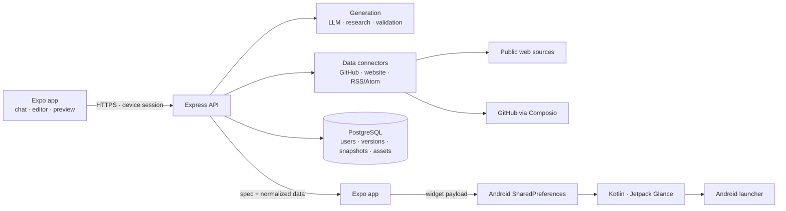

# WidgetComposer architecture

This document describes both the system that exists today and the intended evolution. “Current” means present in this repository; “planned” means a gap, not an implemented feature.

## Current system

WidgetComposer is a modular monolith. The AI produces a versioned declarative widget spec; trusted backend modules fetch and normalize data; the mobile app stores the latest payload for Kotlin/Glance to render. The model does not generate Android code.

### Mobile and native runtime

- The client is Expo/React Native with Expo Router. It owns chat, widget editing, preview, and API calls.
- The widget runtime is a local Expo native module implemented in Kotlin with Jetpack Glance. A development build or installed app containing this module is required; Expo Go cannot load arbitrary custom native code ([Expo documentation](https://docs.expo.dev/workflow/customizing/)).
- The app writes the widget spec and last fetched data to Android `SharedPreferences`. The launcher widget reads that local payload and does not hold API credentials or fetch network data itself.
- The project does not currently use Room, DataStore, a native image-file cache, or WorkManager.

### Backend and storage

- The API is Express 5 + TypeScript, with Zod validation and PostgreSQL through `pg`.
- Authentication is currently anonymous per device, using API-issued access and rotating refresh tokens. It is not Supabase Auth.
- PostgreSQL stores widget specs and versions, device/widget instance mappings, refresh snapshots, generation runs, and user-owned image assets. The image-studio route uses NVIDIA Build FLUX.2 Klein 4B when configured; provider credentials remain server-side. There is no Supabase Storage or Redis dependency.
- Ownership is enforced by API queries scoped to `user_id`; PostgreSQL Row Level Security is not configured. The database is intended to be accessed by the API, not directly by mobile clients.
- Rate-limit counters are in memory. They are suitable for one API process, not coordinated across replicas.

### Generation and widget contract

- The backend owns the authoritative Zod spec validation and flat JSON Schema used for structured generation. The model returns a flat node list; the backend reconstructs the tree, validates bindings and limits, and may request bounded repairs.
- Image Studio stores generated images as durable user-owned assets and returns authenticated metadata/image retrieval. Images are normalized to JPEG and capped at 512 KB for widget transport; WidgetSpec v9 can reference an asset as a background.
- Role prompts are composed into the generation prompt. Research, website reading, image generation, and validation are backend capabilities; this is not a collection of independently running agents making arbitrary tool calls.
- Backend TypeScript, app TypeScript, and Kotlin each encode parts of the widget contract. They currently agree by convention, not by importing one generated shared package. This creates a schema-drift risk.
- The renderer uses a fixed component registry and data bindings. Specs cannot include executable code. `open_url` targets must resolve to connector-provided URLs.

### Data engine and refresh lifecycle

- Providers are registered in the backend catalog. Current providers include GitHub via Composio, public website inventory, RSS/Atom news, and on-device Android metrics.
- The news connector accepts a public HTTPS publisher or feed URL, discovers an advertised RSS/Atom feed, normalizes story titles, summaries, dates, links, source names, and thumbnails, and falls back to bounded linked headlines when a site does not advertise a feed.
- `widget_snapshots` stores the latest normalized data per widget and version. `refreshMinutes` is a cache freshness preference. A stale read or explicit refresh causes the API to fetch data; a failed refresh keeps the last good snapshot and records the latest error.
- The app fetches and syncs widget data when it loads/returns to the foreground and when a user triggers refresh. There is no scheduled server worker or Android WorkManager job, so `refreshMinutes` is not a promise of a background update at that exact interval.
- If WorkManager is added, its periodic requests are inexact and have a 15-minute minimum interval ([Android documentation](https://developer.android.com/develop/background-work/background-tasks/persistent/getting-started/define-work)).

## Data model today

| Table | Current role |
| --- | --- |
| `users`, `refresh_tokens` | Anonymous device identity and API sessions |
| `widgets`, `widget_versions` | Owned widget metadata and immutable specs |
| `widget_instances` | Mapping from app/device widget placements to saved widgets |
| `connectors`, `connector_credentials`, `oauth_states` | Connected provider metadata and protected OAuth state |
| `widget_snapshots` | Latest normalized data, fetch timestamps, and last refresh error |
| `widget_image_assets` | User-owned widget images stored in PostgreSQL |
| `generation_runs` | Generation outcome, model, attempts, latency, and token counts |

There are no separate `widget_sources`, `widget_content_cache`, `widget_refresh_logs`, or `widget_templates` tables today. Data source definitions are embedded in versioned widget specs; snapshots are per widget rather than per source; refresh history is not retained as a sequence of records.

## Gaps and planned additions

### Priority 1: reduce contract drift

Create a shared contract package or generate app/backend TypeScript types and binding definitions from one versioned schema. Keep Kotlin validation/rendering aligned through generated constants or a contract compatibility check. Include schema migrations and compatibility rules when fields or component behavior change.

### Priority 2: improve refresh observability and execution

- Add refresh history with source, start/end time, result, and safe error code. Keep tokens, credentials, prompts, and image bytes out of operational logs.
- Add a durable job queue only when the product needs proactive server refreshes, retries across process restarts, or coordination across API replicas. Until then, cache-on-read plus user refresh is simpler.
- If background refresh is implemented on Android, schedule best-effort WorkManager work, respect Android battery policy, and retain manual refresh. Do not promise exact timing.

### Priority 3: improve device caching when needed

Keep `SharedPreferences` for the current small widget payload. Consider Room when the device needs many normalized snapshots, offline query/update semantics, or history. Store downloaded images as bounded files and cache file references instead of repeatedly copying large base64 payloads through preferences. Use DataStore only for small settings/preferences.

### Scale-up options, not current requirements

- Redis/shared rate-limit storage is needed when multiple API replicas must coordinate rate limits or jobs.
- Supabase Auth or Storage is an optional migration, not a prerequisite: adopt it only if managed identity, sharing, or object-storage needs justify the migration. If the mobile app ever accesses Supabase tables directly, add and verify Row Level Security first.
- Add weather, calendar, and more news providers as separately validated connectors. Keep provider credentials server-side and normalize responses into the same bounded data contract.
- Add templates/marketplace only when reusable widget publishing and sharing become product requirements.

## Security and reliability rules

- Validate model output with the backend schema before storing or rendering it.
- Fetch only public HTTPS URLs; reject private/local addresses, validate redirect destinations, pin DNS resolution for requests, and bound response size and time.
- Keep connector tokens and API keys on the backend. Widget payloads contain only normalized data needed for display.
- Bound image MIME type, size, and dimensions. Resolve images through trusted connector data, not arbitrary widget URLs.
- Keep the last good snapshot on refresh failure. Return stable API error codes and log refresh/generation outcomes without secrets.
- Apply per-user ownership checks to every widget, version, asset, and instance operation.

## Decisions to revisit

1. Whether updates should be pull-on-open/manual or proactively scheduled.
2. Whether the shared widget contract should be generated from JSON Schema or published as a TypeScript package plus Kotlin compatibility layer.
3. Whether account sign-in and cloud image storage justify replacing the current device sessions and PostgreSQL image storage.
4. Whether multi-replica deployment requires Redis or a durable queue.

Do not replace Express, PostgreSQL, or the current auth flow solely to match a proposed stack diagram. Keep the modular monolith until measured scale or product requirements justify those changes.
